# Laporan Evidence

Pengujian endpoint memakai **Thunder Client** (ekstensi VS Code) terhadap server lokal
`http://localhost:3000`. Perubahan database diamati lewat **Neon Tables**.

Kondisi awal database setiap kali pengujian dimulai: 2 produk hasil `npm run seed`,
yaitu Buku (id 1) dan Pulpen (id 2).

## Daftar skenario

| No | Skenario | Status |
| -- | -------- | ------ |
| 1 | GET seluruh produk | 200 |
| 2 | GET satu produk | 200 |
| 3 | GET id tidak ada | 404 |
| 4 | GET id bukan angka | 400 |
| 5 | POST produk baru | 201 |
| 6 | POST tanpa field price | 400 |
| 7 | PUT mengubah produk | 200 |
| 8 | PUT id tidak ada | 404 |
| 9 | DELETE produk | 200 |
| 10 | DELETE id tidak ada | 404 |

---

# GET

## 1. GET /products

Mengambil seluruh produk. Sekaligus memperlihatkan kondisi awal database: 2 produk.

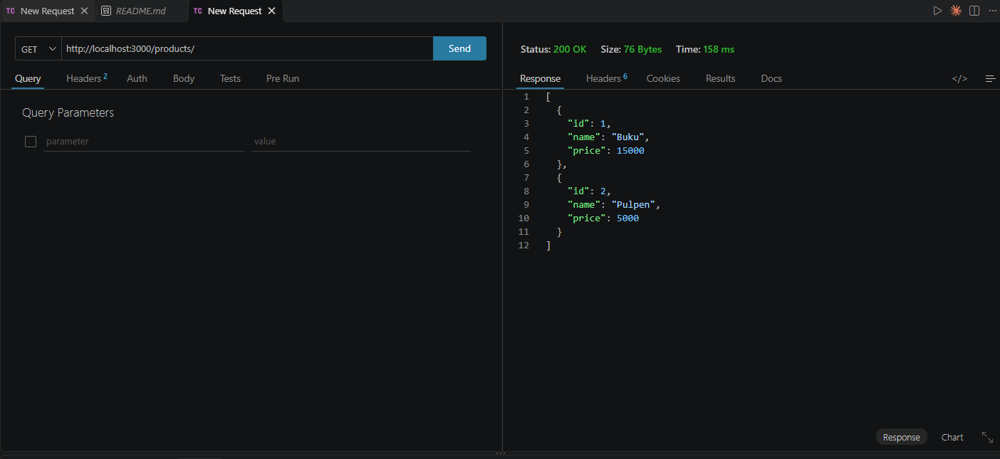

Status `200 OK`.

## 2. GET /products/1

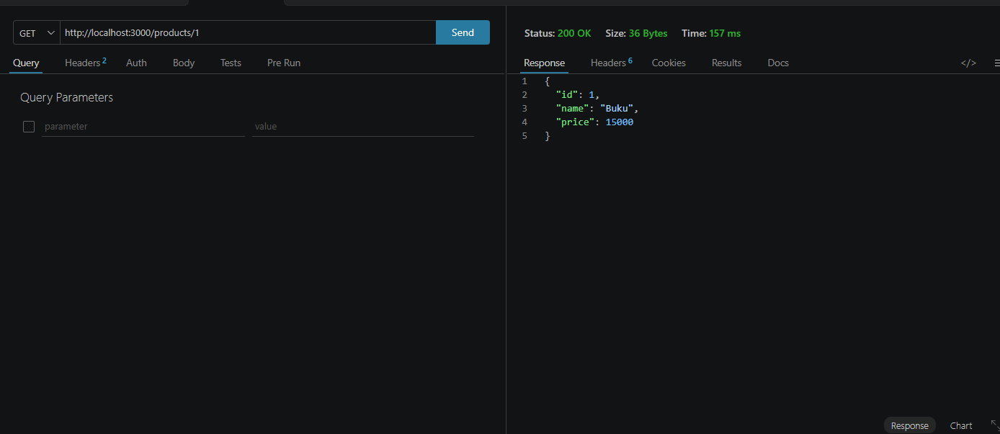

Status `200 OK`, satu objek produk.

## 3. GET /products/999 (id tidak ditemukan)

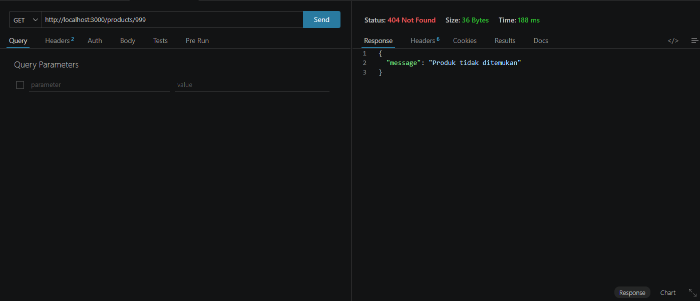

Status `404 Not Found`. Prisma `findUnique` mengembalikan `null`, lalu controller
membalas 404.

## 4. GET /products/abc (kesalahan validasi)

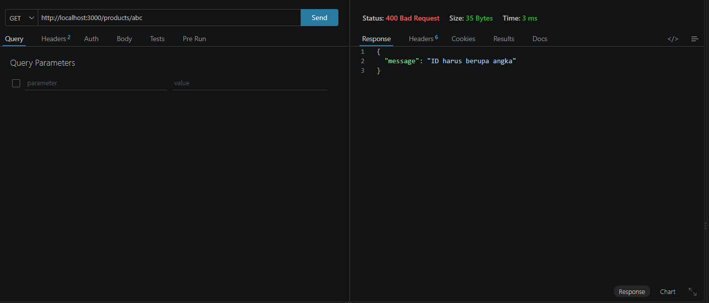

Status `400 Bad Request`. `abc` tidak bisa diubah jadi angka, jadi ditolak sebelum
menyentuh database.

---

# POST

## 5. POST /products (berhasil)

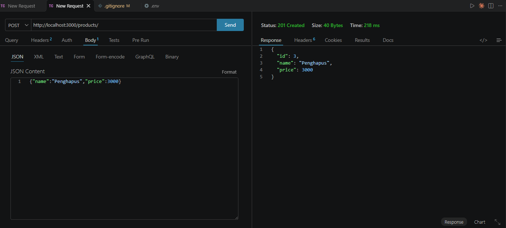

Status `201 Created`. Field `id` tidak dikirim oleh klien, melainkan dibuat oleh
PostgreSQL lewat `autoincrement()`.

### Perubahan database setelah POST

Sebelum: 2 baris (lihat screenshot nomor 1, id 1 dan 2).

Sesudah:

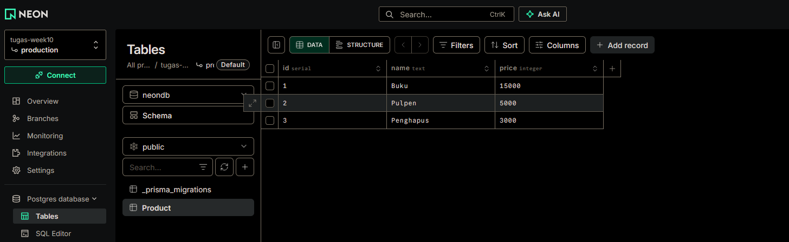

Baris baru id 3 Penghapus 3000 bertambah.

## 6. POST /products tanpa price (kesalahan validasi)

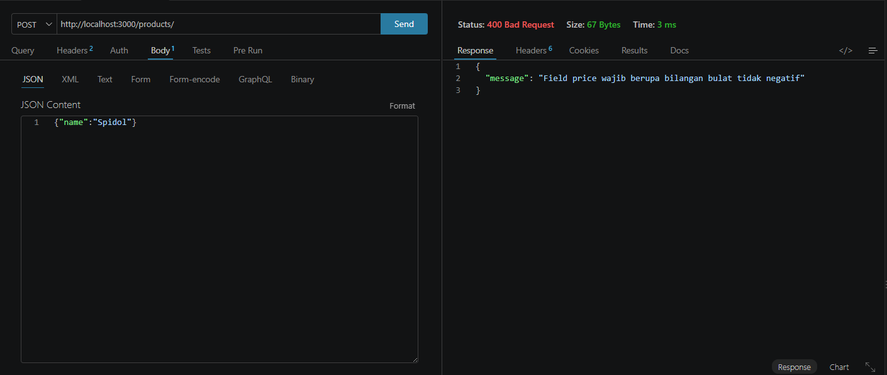

Status `400 Bad Request`. Data tidak masuk ke database.

---

# PUT

## 7. PUT /products/3 (berhasil)

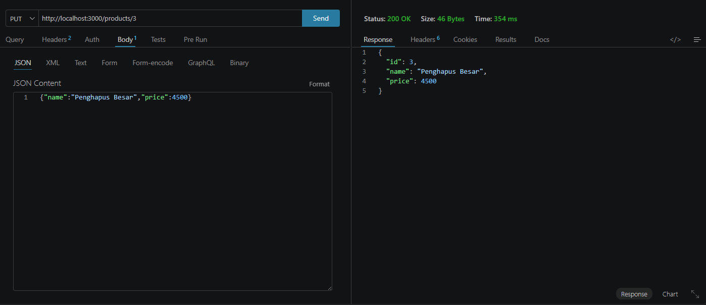

Status `200 OK`. Seluruh field dikirim ulang, karena PUT mengganti isi produk.

### Perubahan database setelah PUT

Sebelum: id 3 berisi Penghapus 3000 (lihat screenshot nomor 5).

Sesudah:

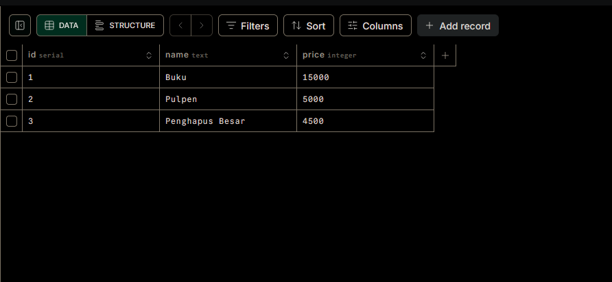

Baris id 3 berubah jadi Penghapus Besar 4500. Jumlah baris tetap 3.

## 8. PUT /products/999 (id tidak ditemukan)

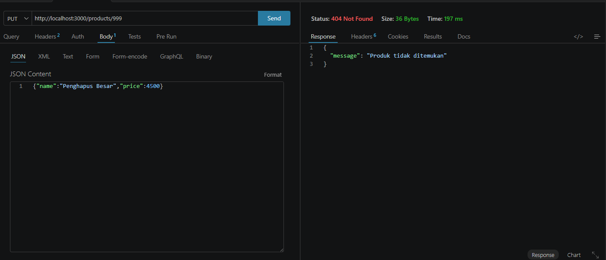

Status `404 Not Found`. Produk dicek keberadaannya lebih dulu, karena
`prisma.update` pada id yang tidak ada akan melempar error.

---

# DELETE

## 9. DELETE /products/3 (berhasil)

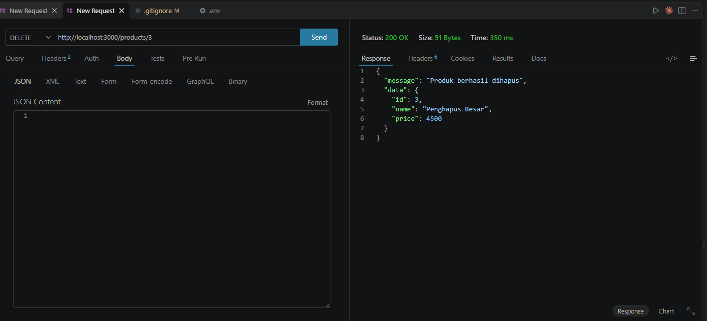

Status `200 OK`. Respons memuat data produk yang dihapus sebagai konfirmasi.

### Perubahan database setelah DELETE

Sebelum: 3 baris (lihat screenshot nomor 7).

Sesudah:

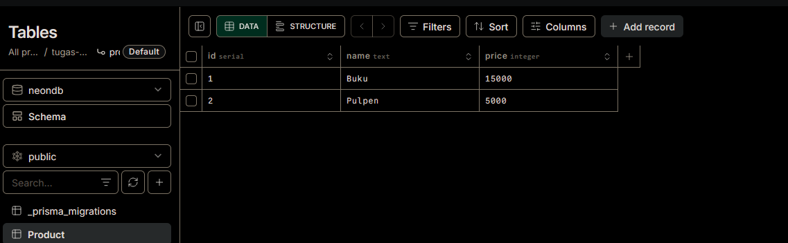

Baris id 3 hilang, tersisa 2 baris seperti kondisi awal.

## 10. DELETE /products/999 (id tidak ditemukan)

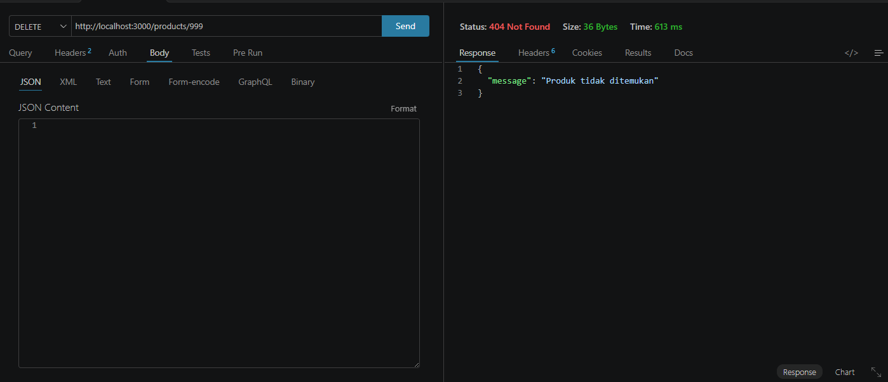

Status `404 Not Found`.

---

# Ringkasan perubahan database

| Tahap | Isi tabel Product |
| ----- | ----------------- |
| Kondisi awal (hasil seed) | id 1 Buku 15000, id 2 Pulpen 5000 |
| Setelah POST | bertambah id 3 Penghapus 3000 |
| Setelah PUT | id 3 berubah jadi Penghapus Besar 4500 |
| Setelah DELETE | id 3 terhapus, kembali 2 baris |

Skenario gagal (400 dan 404) tidak mengubah isi database sama sekali.
